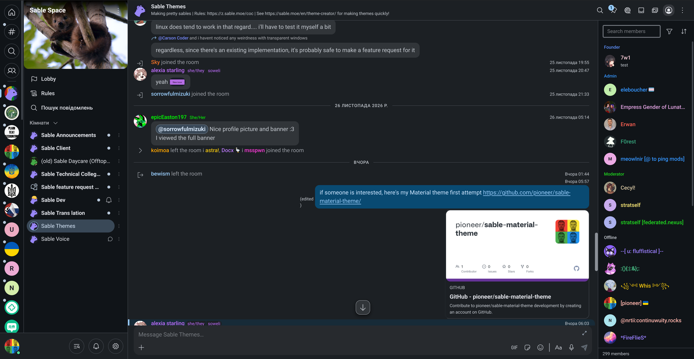
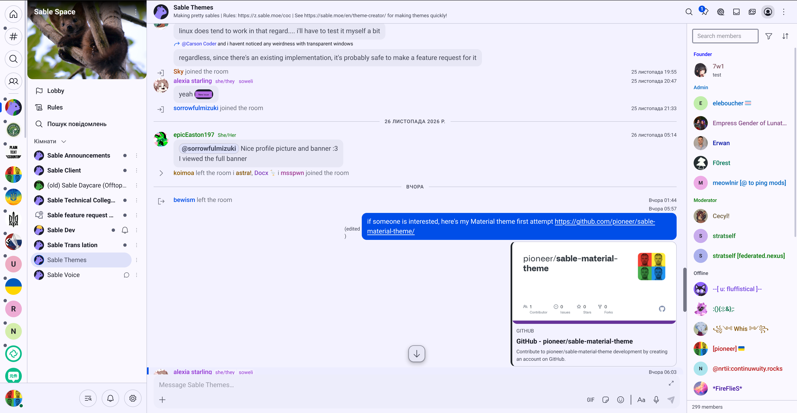
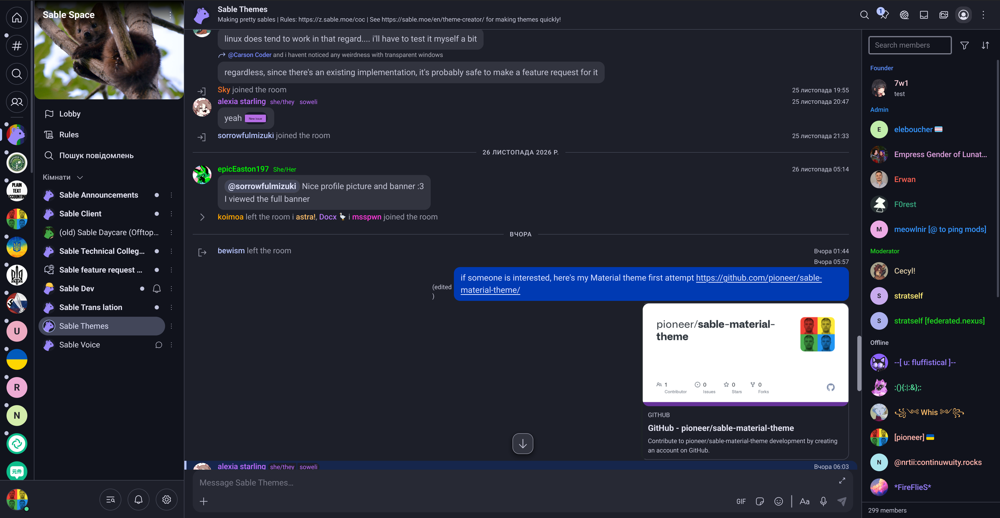

# Material Themes for Sable

Material 3-inspired themes for Sable, with rounded controls and light and dark
variants. The themes keep Sable's existing icons and your font settings.

## Preview

Material Purple Light on desktop.

Material Purple Dark on desktop.

Material Blue Light on desktop.

Material Blue Dark on desktop.

Material Blue Vibrant Light on desktop.

Material Blue Vibrant Dark on desktop.

## Choose a theme

- **Purple** — soft purple accents:
  [Material Purple Light](./material-purple-light.sable.css) and
  [Material Purple Dark](./material-purple-dark.sable.css).
- **Blue** — soft blue accents:
  [Material Blue Light](./material-blue-light.sable.css) and
  [Material Blue Dark](./material-blue-dark.sable.css).
- **Blue Vibrant** — vibrant blue accents, seeded by Material 2's Blue A700
  swatch (`#2962ff`):
  [Material Blue Vibrant Light](./material-blue-vibrant-light.sable.css) and
  [Material Blue Vibrant Dark](./material-blue-vibrant-dark.sable.css).

## Install

1. Download the light and/or dark theme files for your preferred color. On
   GitHub, open each file and select **Download raw file**.
2. In Sable, open **Settings → Appearance**, select **Import file**, and import
   each downloaded file.
3. Select your light theme under **Light mode** and/or your dark theme under
   **Dark mode**. Use **Light or dark** to choose a mode or follow your system
   setting.

If someone shares a theme file in Sable chat, you can select **Install** on the
attachment instead of downloading and importing it. Then select the theme in
Appearance.
