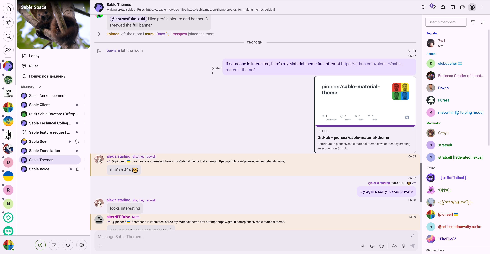
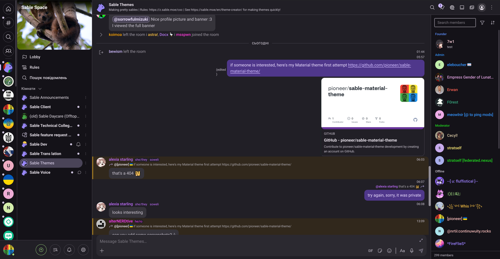
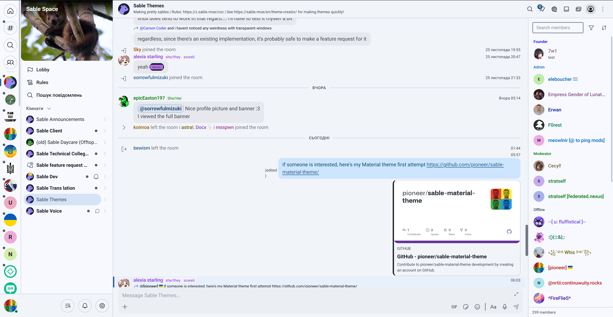
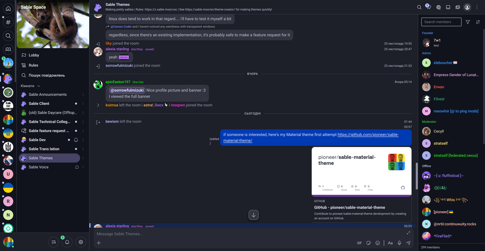

# Material Themes for Sable

Material 3-inspired themes with rounded controls and light and dark variants.
Choose purple, light blue or deeper blue accents; the themes keep Sable's existing
icons and your font settings.

## Preview

Material Purple Light on desktop.

Material Purple Dark on desktop.

Material Blue Light on desktop.

Material Blue Dark on desktop.

Material Blue A700 Light on desktop.

Material Blue A700 Dark on desktop.

## Choose a theme

- [Material Purple Light](./material-purple-light.sable.css) — soft, light surfaces
  with purple accents.
- [Material Purple Dark](./material-purple-dark.sable.css) — dark surfaces with
  lavender accents.
- [Material Blue Light](./material-blue-light.sable.css) — near-white surfaces
  with light blue accents.
- [Material Blue Dark](./material-blue-dark.sable.css) — dark surfaces with
  soft blue accents.
- [Material Blue A700 Light](./material-blue-a700-light.sable.css) — near-white
  surfaces with vibrant blue accents and filled blue outgoing bubbles.
- [Material Blue A700 Dark](./material-blue-a700-dark.sable.css) — dark surfaces
  with vibrant blue accents and deep blue outgoing bubbles.

Blue A700 uses Material's named Blue A700 color (`#2962ff`) as the seed for a
Material 3 vibrant scheme. Its filled outgoing bubbles apply only in the bubble
timeline layout; the other layouts retain their existing presentation.

## Install

1. Download the light and/or dark theme files for your preferred color. On
   GitHub, open each file and select **Download raw file**.
2. In Sable, open **Settings → Appearance**, select **Import file**, and import
   each downloaded file.
3. Select your light theme under **Light mode** and/or your dark theme under
   **Dark mode**. Use **Light or dark** to choose a mode or follow your system
   setting.

If someone shares a theme file in Sable chat, you can select **Install** on the
attachment instead of downloading and importing it. Then select the theme in
Appearance.
